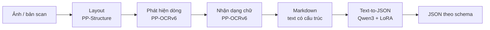
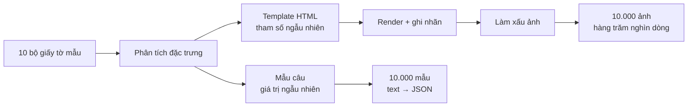

  
Nhập tay trước đây3–10 phútcho mỗi trang giấy tờ

  
Dữ liệu ban đầu10 bộnhân lên thành 20.000 mẫu tổng hợp

  
Model trích xuất0,6Bcho phần lớn giấy tờ, tối đa 4B

  
Ngưỡng nghiệm thu&gt; 95%độ chính xác ký tự và F1 theo trường

Năm 2026, nói "đang làm OCR" nghe hơi giống nói "đang viết jQuery". VLM đọc thẳng ảnh ra JSON, cần gì layout, cần gì nhận dạng từng dòng. Dự án này cũng bắt đầu đúng như thế.

Hệ thống được xây cho hai mục đích:

| Mục đích | Trước khi có hệ thống |
|---|---|
| **Dịch vụ trực tiếp** cho giao dịch viên tại quầy | Nhìn căn cước, sao kê, hợp đồng, giấy tờ tài sản rồi gõ lại vào hệ thống, mỗi trang mất **3 đến 10 phút** |
| **Engine đọc giấy tờ** cho lending agent, nơi tín dụng viên và thẩm định viên xử lý hồ sơ vay | Agent cho GPT đọc ảnh ra text, nhưng không có con số nào cho biết nó đọc đúng đến đâu |

Cả hai cần chung một thứ: đọc giấy tờ đúng với chất lượng đo được.

Thứ cuối cùng lên production lại là một pipeline năm bước kiểu "cũ": layout, phát hiện dòng, nhận dạng chữ, ghép thành Markdown, rồi một LLM 0,6 tỷ tham số chuyển Markdown thành JSON. Bài này kể vì sao.

## 1. VLM: hấp dẫn trên demo, đáng sợ trên giấy tờ thật

### Thử, fine-tune, rồi bỏ

Điểm xuất phát là một VLM cỡ khoảng 1,6 tỷ tham số. Bản gốc chưa đủ tốt nên được fine-tune thêm trên dữ liệu giấy tờ. Ba lỗi vẫn không biến mất:

- **Bịa nội dung.** Model điền vào trường những giá trị không hề có trên ảnh, trông hoàn toàn hợp lệ.
- **Lặp chữ.** Đang đọc thì một cụm từ lặp đi lặp lại, kể cả khi đã phạt lặp lúc sinh.
- **Không chịu nhận là trang trống.** Gặp một trang trắng hoặc không có chữ, model vẫn khẳng định trên đó có ký tự rồi "đọc" ra nội dung. Có lúc nó còn sinh thêm một đoạn văn giải thích, phá vỡ luôn định dạng JSON mà hệ thống phía sau chờ nhận.

### Vì sao "bịa" là lỗi không thể chấp nhận

Một ô để trống thì người sử dụng có thể thấy ngay và tự điền. Một con số bịa nhưng đúng định dạng thì không ai nghi ngờ. Nó đi thẳng vào hồ sơ khách hàng. Đối với đặc thù ngành ngân hàng, **thà không đọc được còn hơn đọc sai mà trông như đúng**.

| | VLM nhỏ đã fine-tune | Pipeline nhiều bước |
|---|---|---|
| Có bịa nội dung không | Có, giá trị không có trên ảnh vẫn xuất hiện | Rất ít: OCR chỉ đọc chữ có trên ảnh; LLM chỉ sắp xếp chữ đã đọc, lỗi thường gặp là nhầm giá trị giữa hai trường hoặc bỏ sót |
| Có lặp chữ không | Có, kể cả khi phạt lặp | Không |
| Gặp trang trống | Bịa ra chữ hoặc sinh lời giải thích sai định dạng | Layout không thấy vùng nào thì dừng ngay, trả về thông báo lỗi trang trống |
| Khi sai, biết sai ở đâu | Không: chỉ có một đầu ra cuối | Có: mỗi bước có đầu ra riêng |
| Sửa lỗi | Fine-tune lại cả model | Sửa đúng bước hỏng |

VLM rất lớn thì đáng tin hơn, nhưng chạy model cỡ đó cho một dịch vụ mà cả ngân hàng gọi vào thì không kinh tế. Hướng đi này cũng khớp với công bố mới của nhóm PaddleOCR: trên benchmark nội bộ của họ, PP-OCRv6 bản medium chỉ có 34,5 triệu tham số nhưng nhận dạng chữ đúng 83,2%, trong khi VLM tốt nhất là Qwen3-VL-235B đạt 74,9%. Trên bộ đo hallucination, PP-OCRv6 đạt 93,2% so với 80,6% của Qwen3-VL-235B ([PP-OCRv6, arXiv 2606.13108](https://arxiv.org/abs/2606.13108)). Benchmark do chính nhà phát triển tự xây nên cần đọc dè dặt, nhưng xu hướng thì giống hệt những gì thấy trên giấy tờ thật.

## 2. Năm bước, bước nào cũng kiểm tra được

Layout chia trang thành 8 loại vùng như chữ, bảng, con dấu, chữ ký, tiêu đề. Vùng chữ được tách thành từng dòng, từng dòng được đọc thành ký tự. Kết quả OCR của các vùng sau đó được ghép lại thành một văn bản Markdown có cấu trúc theo đúng thứ tự trên trang, tối ưu cho cả người lẫn LLM đọc. Cuối cùng một LLM nhỏ đọc bản Markdown đó và trả về JSON theo schema của từng loại giấy tờ.

Điểm đáng tiền nhất của cách chia này không nằm ở bước nào cả, mà ở chỗ **mỗi bước có đầu vào, đầu ra riêng và kiểm tra được**. Một trường JSON sai thì biết ngay là do layout cắt thiếu vùng, do OCR đọc nhầm ký tự, do bản Markdown ghép sai thứ tự hay do LLM trích sai. Với VLM, chỉ biết là nó sai.

## 3. Không có dữ liệu thì tự làm ra dữ liệu

### Ba cánh cửa đều đóng

- Bên đặt bài toán muốn dùng AI nhưng **không có dữ liệu gán nhãn**.
- **AI bên ngoài bị chặn trên máy phát triển** để tránh lộ dữ liệu và mã nguồn. Chỉ còn một LLM nội bộ, chất lượng hạn chế.
- Kho hơn 100.000 mẫu cho bước trích xuất thì **phần lớn là rác**.

### Mười bộ giấy tờ thành hai mươi nghìn mẫu

Thay vì vẽ ảnh hay gán nhãn tay, lời giải là viết HTML.

Với mỗi loại giấy tờ, đặc trưng được phân tích từ vài mẫu thật: bố cục, font, cỡ chữ, khoảng cách, vị trí con dấu, kiểu bảng. Từ đó dựng thành template HTML, nơi **mọi thứ đều là tham số ngẫu nhiên trong khoảng cho phép**. Render template ra ảnh rồi làm xấu ảnh đi. Vì từng chữ đều do template đặt vào trang nên nhãn có sẵn, chính xác đến từng ký tự, kể cả vị trí từng vùng cho bước layout.

20.000 mẫu tổng hợp phủ cả luồng, chia đều cho hai việc:

| Phần | Số mẫu | Dùng cho |
|---|---:|---|
| Ảnh render từ template HTML | 10.000 | Layout, phát hiện dòng, nhận dạng chữ. Cắt theo dòng ra **hàng trăm nghìn ảnh dòng** để train OCR |
| Đoạn văn sinh từ mẫu câu | 10.000 | Trích xuất JSON. Giá trị ngẫu nhiên hợp lệ được bơm vào câu, ghi lại đúng giá trị đó làm nhãn |

Phần "làm xấu ảnh" là chỗ giấy tờ Việt Nam bắt đầu khó:

| Ca khó | Cách đưa vào dữ liệu |
|---|---|
| Dấu tiếng Việt, font lạ | Render bằng nhiều font, cỡ chữ, độ đậm |
| Bảng không kẻ khung | Template có cả bảng kẻ và không kẻ |
| Con dấu đóng đè lên chữ | Chèn con dấu ngẫu nhiên lên vùng chữ |
| Scan mờ, nghiêng, nhiễu | Biến đổi ảnh sau khi render |
| Chữ viết tay | Bổ sung bộ dữ liệu chữ viết tay công khai |

### Dữ liệu thật thì soát bằng mắt

Dữ liệu tổng hợp chỉ để làm giàu, không thay được dữ liệu thật: trong tập train, phần tổng hợp chiếm **tối đa 50%**. Với kho hơn 100.000 mẫu thật cho bước trích xuất, các luật viết bằng code lọc rác trước, LLM nội bộ tạo nhãn nháp, rồi người soát lại phần còn nghi ngờ. Kết quả còn khoảng **10.000 mẫu sạch**. Chậm, nhưng như phần sau sẽ cho thấy, đây là phần đáng làm nhất.

## 4. Vì sao 0,6 tỷ tham số là đủ

### Một model cho tất cả? Không

Định hướng ban đầu là một model 8 tỷ tham số đọc mọi loại giấy tờ. Nghe gọn, nhưng thực tế model 8B cũng không bao quát nổi, mà còn chậm. Thay vào đó, giấy tờ được gom thành ba nhóm có cấu trúc gần nhau, mỗi nhóm một model nhỏ fine-tune bằng LoRA:

| Nhóm giấy tờ | Model |
|---|---|
| Giấy tờ ngắn: căn cước, chứng minh thư, bằng lái, các loại thẻ | Qwen3 0,6B |
| Các nhóm hồ sơ vay có cấu trúc gần nhau | Qwen3 1,7B |
| Nhóm phức tạp nhất | Qwen3 4B |

Mỗi nhóm có prompt và schema cố định. Chính sự cố định đó giúp model nhỏ đã fine-tune đủ sức vượt ngưỡng nghiệm thu: nó không phải đoán người dùng muốn gì, chỉ cần làm đúng một việc.

### Ba bài học ngược trực giác

| Tưởng là | Thực tế |
|---|---|
| Càng nhiều dữ liệu càng tốt | Model nhỏ học quá nhiều dữ liệu một nhóm bị **catastrophic forgetting**, quên dần kiến thức gốc và kém đi ở các loại giấy tờ khác |
| Có dữ liệu là fine-tune được | Dữ liệu chưa sạch cho kết quả **còn thấp hơn model gốc** chưa fine-tune |
| Model to hơn thì tổng quát hơn | Một model 8B chung vẫn thua các model nhỏ chia theo nhóm, lại chậm hơn |

Bài học thứ hai là lý do phải ngồi soát tay dữ liệu. Fine-tune trên dữ liệu bẩn không chỉ phí công, nó làm model tệ hơn lúc chưa đụng vào.

## 5. Chốt phạm vi trước khi làm

Ngay từ đầu dự án, tập test và ngưỡng được chốt cùng tester và bộ phận nghiệm thu. Độ chính xác ký tự (1 − CER) và F1 theo từng trường đều phải trên 95% thì mới được triển khai. Qua ngưỡng rồi vẫn chưa bật cho tất cả, mà chạy early access để người dùng thật thử và phản hồi trước.

Nghe thủ tục, nhưng nó loại bỏ câu hỏi mệt mỏi nhất của mọi dự án AI: "model tốt hơn rồi", tốt hơn theo nghĩa nào và trên dữ liệu nào? Cách cho GPT đọc ảnh trong lending agent trước đây chưa từng trả lời được câu đó.

Pipeline chạy trên Triton Inference Server, gọi qua gRPC, trên Kubernetes với GPU A100. Bước OCR mất khoảng gấp đôi thời gian của LLM, nên nếu cần tối ưu tốc độ, chỗ để bắt đầu không phải là model ngôn ngữ.

## 6. Nếu làm lại từ đầu

- **Thử VLM, nhưng đo nó như mọi thứ khác.** Đừng chọn vì nó mới và được nhiều người quan tâm. Chọn vì nó qua được tập test.
- **Chia bước để biết sai ở đâu.** Một hệ thống không giải thích được lỗi của chính nó thì rất khó cải thiện.
- **Không có dữ liệu thì hiểu dữ liệu trước khi sinh dữ liệu.** Template chỉ tốt khi khoảng ngẫu nhiên đến từ giấy tờ thật.
- **Dữ liệu sạch quan trọng hơn dữ liệu nhiều.** Dữ liệu bẩn làm model fine-tune kém hơn cả lúc chưa fine-tune.
- **Synthetic để làm giàu, không để thay thế.** Dữ liệu tổng hợp chỉ hỗ trợ training; tối đa 50% tập train, phần còn lại phải là dữ liệu thật.
- **Chia nhỏ bài toán thay vì tìm một model cho tất cả.**
