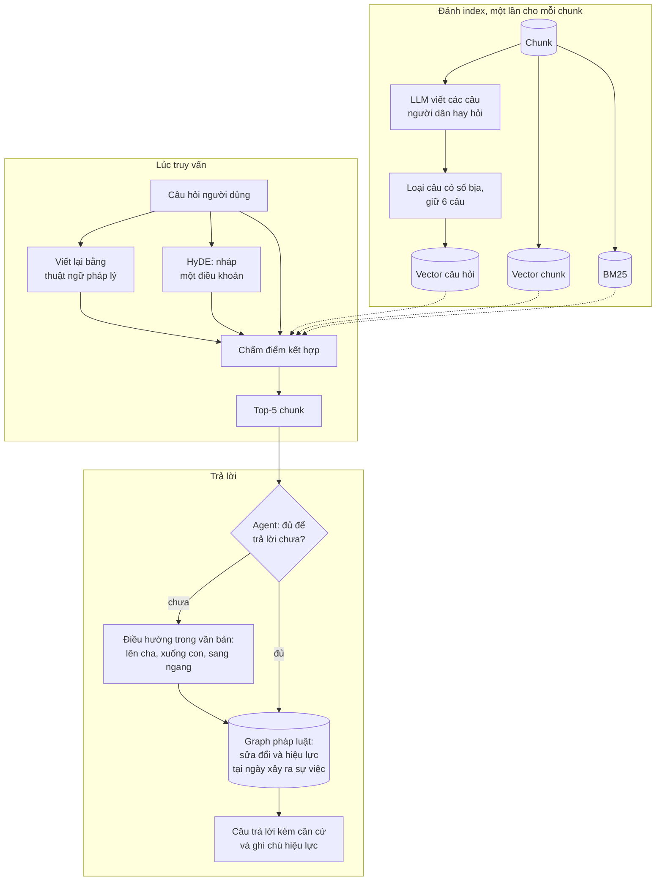

  
Hit@590,5%▲ từ 78,5%

  
Acc@168,2%▲ từ 54,0%

  
Token gửi cho LLM3.560▼ 59% so với 8.666

  
Lỗi tìm kiếm thật3 / 400sau khi phân loại 38 câu sai

Ai làm RAG chắc cũng từng gặp cảnh agent dẫn sai chunk mà không rõ vì sao. Lên mạng hay hỏi LLM, câu trả lời gần như luôn giống nhau: embedding + BM25 + rerank. Hệ thống trong bài này làm đúng như vậy, thậm chí đã benchmark 18 model embedding, nhưng vẫn dẫn sai. Chỉ khi đọc lại từng câu sai, nguyên nhân mới lộ ra: ***người hỏi và văn bản luật dùng từ khác nhau***.

Lời giải cuối cùng là dịch theo hai chiều: gắn cho mỗi chunk những câu người dân hay hỏi và viết lại câu hỏi sang ngôn ngữ pháp lý trước khi tìm. Trên đường đi, 379 cấu hình chunking, reranker, bộ lọc metadata và tự động tối ưu prompt đều đã được thử và bị loại. Bài này đi qua từng bước, kèm số đo.

## 1. Bài toán: người hỏi một đằng, luật viết một nẻo

### Một câu hỏi, một điều khoản sai

> *"Tiền thu hồi nợ xấu được dùng để trả cái nào trước?"*

| Người hỏi nói | Văn bản luật viết | Hệ thống cũ dẫn |
|---|---|---|
| "trả cái nào trước" | "thứ tự ưu tiên thanh toán" (Điều 42 Thông tư 19/2013/TT-NHNN) | Điều 49, chỉ vì trùng cụm "thu hồi nợ xấu" |
| "dùng thuốc nổ", "xuống kiểm tra" | "VLNCN" (vật liệu nổ công nghiệp), Điều 16 Quyết định 17/2001/QĐ-UB | Điều 8, chỉ nói về thanh tra an toàn lao động |

Với embedding, "thuốc nổ" và "VLNCN" là hai chuỗi không liên quan. Với tìm kiếm từ khóa, chúng không có điểm chung nào.

### Bối cảnh hệ thống

| Hạng mục | Chi tiết |
|---|---|
| Kho dữ liệu | Hơn 500.000 văn bản, chia theo Điều, Khoản, Điểm thành hơn 10 triệu chunk |
| Người dùng | Tư vấn luật, cán bộ soạn thảo văn bản ở địa phương, nhân viên hành chính công |
| Tình trạng | Đã lên production, trả lời tự tin nhưng dẫn sai điều khoản |
| Vai trò cá nhân | Thiết kế lại pipeline retrieval |

## 2. Đo cho đúng trước khi sửa

### Baseline đang chạy

Hệ thống production lúc đó chỉ embedding **256 token đầu** của mỗi chunk, dù có chunk dài tới 8.000 token; Acc@1 trên bộ 400 câu chỉ đạt 45,2%. Mọi thí nghiệm bên dưới chạy trên một tập con 204 văn bản (6.291 chunk), để mỗi ý tưởng đánh index lại và chấm điểm trong vài phút.

### Từ bộ test dễ đến bộ test khó

Bộ test đầu tiên do LLM viết từ chính các chunk, nên câu hỏi lặp lại câu chữ của chunk; BM25 hay chèn tên văn bản là tìm ra gần hết. Nhưng người dùng thật không hỏi như vậy và nếu hệ thống đã tốt với câu hỏi thật thì đã chẳng cần làm lại. Vì thế có thêm hai bộ khó hơn:

| Bộ câu hỏi | Đặc điểm | Hit@5 (BGE-M3 + BM25) |
|---|---|---:|
| 200 ban đầu | Câu dài, bám sát nội dung chunk, có từ khóa và ý rõ ràng | 90,0% |
| 100 câu mơ hồ | Câu rút gọn, thiếu chi tiết đặc trưng, không tên văn bản, không con số | 87,0% |
| 100 câu ngắn, diễn đạt lại | Khoảng 10 âm tiết, chỉ 19% từ trùng với đáp án; người hiểu luật cũng phải hỏi lại mới chắc ý | **47,0%** |

<figure class="chart" markdown="0">
  
Chỉ đổi cách nói đã mất 30 điểm Hit@5

  
Thí nghiệm kiểm soát trên 81 câu của bộ mơ hồ: giữ nguyên ý, chỉ đổi cách diễn đạt.

  
</figure>

Lỗi thật nằm ở **khoảng cách từ ngữ**, không nằm ở model.

### Nguyên tắc chấm điểm

| Nguyên tắc | Cách làm |
|---|---|
| Hit@5 là chỉ số chính | LLM đọc 5 chunk đầu; Acc@1 là chỉ số phụ |
| Rà lại nhãn sau mỗi lần chạy | Một agent lớn làm reviewer đọc đủ chunk trong top 10, đánh dấu nếu chunk trả lời tốt hơn nhãn. Đáp án gọn trong 1 chunk thì chunk đó phải đứng đầu; đáp án trải nhiều chunk thì chunk đầu phải chứa phần lớn ý |
| Kiểm mù nhãn của bộ khó | Agent thứ hai tự tìm đáp án độc lập; agent thứ ba chấm từng cặp câu hỏi–chunk, xen 30 cặp cố tình ghép sai. Cả 30 cặp sai đều bị bác |
| Câu lỗi thì thay, không bỏ | 17 câu đã được thay, mọi thứ đánh index lại |
| Thêm dưới ~1 điểm Hit@5 thì cắt | Thành phần nào cũng tốn độ trễ và công bảo trì |

Baseline cho phần còn lại là cách sửa hiển nhiên nhất: **BGE-M3 đọc toàn bộ chunk + BM25**, đạt 78,5% Hit@5 và 54,0% Acc@1 trên cả 400 câu.

## 3. Hướng đi đầu tiên: chia lại chunk

### 379 cấu hình, gần như không đổi gì

24 phương án với 379 cấu hình được thử trên cả ba bộ câu hỏi: cắt nhỏ, gộp, tách theo tầng Điều–Khoản–Điểm, cắt cố định theo token, thêm ngữ cảnh mục cha, gắn tên văn bản và dùng LLM sinh tóm tắt, từ khóa, mệnh đề, câu hỏi cho từng chunk.

<figure class="chart" markdown="0">
  
Trên bộ câu ngắn, chỉ câu hỏi giả định tạo khác biệt

  
Acc@1 trên 100 câu ngắn, diễn đạt lại. 14 phương án không dùng LLM đều nằm trong khoảng 14–26%; cắt nhỏ chunk còn làm Hit@5 tụt từ 47% xuống 31–38%.

  
</figure>

Thử 379 cấu hình thì kiểu gì cũng có vài cấu hình "trông tốt" do may rủi, nên mọi kết quả đều qua **kiểm định đồng thời** với ngưỡng t ≈ 3,2 thay vì 1,645. Trên bộ câu ngắn, chỉ duy nhất cấu hình câu hỏi giả định vượt ngưỡng (t = 3,3). Tóm tắt, từ khóa và mệnh đề do LLM viết không giúp gì thêm.

### Gắn tên văn bản và BM25: chỉ giúp câu hỏi dễ

| Mức thay đổi Acc@1 | Bám sát câu chữ | Mơ hồ | Ngắn, diễn đạt lại |
|---|---:|---:|---:|
| Gắn tên văn bản vào chunk | **+14,5** | +5,0 | +3,0 (trong sai số) |
| Thêm BM25 | +2,5 | +7,0 | **−3,0** |

Gắn tên văn bản chỉ giúp khi người hỏi đã nhắc tên văn bản, điều người dùng thật hiếm khi làm. BM25 giúp câu bám chữ nhưng làm câu ngắn tệ đi và trộn hạng kiểu RRF không giúp ở bộ nào. Vấn đề không nằm ở cách chia chunk, mà ở khoảng cách từ ngữ.

## 4. Giải pháp: dịch theo cả hai chiều

### Phía index và phía truy vấn

| Phía | Bước | Cách làm |
|---|---|---|
| Index | Câu hỏi giả định | LLM viết 5 câu theo cách người dân hỏi, thêm 5 câu khác lượt đầu, loại câu có con số không có trong chunk, giữ 6 câu làm vector riêng |
| Truy vấn | Viết lại câu hỏi | Diễn đạt lại bằng thuật ngữ pháp lý, không thêm sự kiện |
| Truy vấn | HyDE | Nháp 2–3 câu giống một điều khoản trả lời câu hỏi (chạy song song với bước viết lại) |
| Truy vấn | Chấm điểm | Vector: trung bình theo câu gốc, câu viết lại, đoạn nháp của cos(chunk) + max cos(6 câu giả định). BM25 trên câu gốc + câu viết lại. Trộn z-score 0,85 / 0,15 |

### Toàn bộ luồng xử lý

### Ví dụ: từ hạng 60 lên hạng 1

<figure class="chart" markdown="0">
  
Câu hỏi nợ xấu: hạng của điều khoản đúng qua từng bước

  
Càng ngắn càng tốt. Câu hỏi giả định gần như y hệt "tiền thu hồi được dùng để trả những khoản nào trước tiên?".

  
</figure>

Câu hỏi thuốc nổ cũng vậy: một câu hỏi giả định viết đủ "vật liệu nổ công nghiệp" và điều khoản đúng đi từ hạng 8 lên hạng 1.

## 5. Kết quả

### Theo từng loại câu hỏi

<figure class="chart" markdown="0">
  
Tăng ít ở câu dễ, tăng mạnh đúng ở chỗ người dùng gặp khó

  
Hit@5 trên từng bộ câu hỏi. McNemar p &lt; 10⁻⁶; khoảng tin cậy 95% cho mức tăng chung: +8,2 đến +15,5 điểm.

  
</figure>

### Thành phần nào đóng góp bao nhiêu

<figure class="chart" markdown="0">
  
Câu hỏi giả định là thành phần mạnh nhất

  
Điểm Hit@5 thay đổi khi bỏ từng thành phần khỏi pipeline và khi thêm riêng từng thành phần vào BGE-M3.

  
</figure>

HyDE và BM25 trùng nhiều với các thành phần khác: đứng riêng thì có ích, trong pipeline thêm rất ít cho Hit@5, dù BM25 vẫn giúp Acc@1.

<figure class="chart" markdown="0">
  
Số câu hỏi giả định cho mỗi chunk: 6 là đủ

  
Hit@5 tăng đều tới 4–6 câu rồi đi ngang, trong khi số vector tăng theo số câu.

  
</figure>

### 38 câu sai còn lại

<figure class="chart" markdown="0">
  
Trong 38 câu sai, chỉ 3 là lỗi tìm kiếm thật

  
Phân loại từng câu trượt khỏi top 5.

  
</figure>

| Nhóm | Hướng xử lý |
|---|---|
| Đúng văn bản, sai điều | Agent điều hướng trong văn bản (phần 7) |
| Đáp án trong phụ lục dài (> 1.500 token) | Tách phụ lục thành chunk nhỏ hơn |
| Bước viết lại hiểu sai | Ví dụ "xe nhà chở hàng nhà" bị viết thành "kinh doanh vận tải"; cần hiểu câu hỏi tốt hơn |

Con số trung thực vẫn là 90,5%, nhưng việc còn lại nằm ở agent, cách chia phụ lục và hiểu câu hỏi, không phải ở bộ tìm kiếm.

## 6. Những mẹo phổ biến đã bị loại

| Mẹo | Kết quả đo được | Quyết định |
|---|---|---|
| **Reranker** (bge-reranker-v2-m3, Qwen3-Reranker; 31 tổ hợp) | Thử trên pipeline có ghép tiêu đề vào chunk (91,8% Hit@5): rerank thuần làm giảm ở mọi tổ hợp, tốt nhất cũng chỉ còn 87,8%, giảm mạnh nhất ở câu diễn đạt lại. Trộn điểm thêm tối đa 0,7 điểm, không có ý nghĩa thống kê, lại tăng độ trễ | Bỏ |
| **Bộ lọc metadata do LLM chọn** (loại văn bản, lĩnh vực, cấp ban hành) | Một tag sai là đáp án đúng biến mất (biểu đồ dưới). Kể cả tag đúng tuyệt đối cũng chỉ thêm 2–5 điểm | Bỏ |
| **Tự động tối ưu prompt** | Tốt lên trên nửa dev, không giữ được trên nửa test (−1,5 đến +0,5) | Bỏ |
| **Từ khóa mục cha, ghép tiêu đề vào vector** | Không có khác biệt đo được (+1,2 điểm, p = 0,33) | Bỏ |

<figure class="chart" markdown="0">
  
Bộ lọc metadata do LLM chọn làm mất đáp án đúng

  
Hit@5 khi lọc kết quả theo tag mà LLM gán cho câu hỏi.

  
</figure>

## 7. Từ tìm kiếm đến câu trả lời

| Tầng | Làm gì | Ví dụ |
|---|---|---|
| **Điều hướng trong văn bản** | Agent đi lên mục cha, xuống mục con, sang ngang mục cùng cấp; mở thêm tối đa 12 chunk rồi trả lời ở lượt hai | Nghị quyết của một tỉnh: top 5 toàn là Điều 1, đáp án là Điều 2 ở hạng 16; agent mở văn bản và trả lời đúng. Một điều chỉ liệt kê chức danh, không chung chữ nào với câu hỏi, cũng chỉ tới được bằng cách này |
| **Kiểm tra hiệu lực bằng graph** | Luật áp dụng theo ngày xảy ra sự việc, trừ khi có hồi tố | Giá đất trong hẻm sâu 150 m: quyết định chỉ có hiệu lực 01/01–31/12/2013, hệ thống cảnh báo đã hết hiệu lực. Nghị quyết chống dịch COVID: báo hết hiệu lực từ cuối năm 2022 |

Bản thân graph pháp luật theo thời gian là câu chuyện của bài sau.

## 8. Vận hành: độ trễ và chi phí

### Độ trễ

<figure class="chart" markdown="0">
  
Một lượt hỏi trung bình mất 5,5 giây, phần lớn là LLM viết câu trả lời

  
Thời gian trung bình theo giai đoạn, đo từng câu một và đã tắt cache. p90 của tổng là 7,22 giây.

  
</figure>

- Khi agent phải điều hướng thêm trong văn bản, cả lượt hỏi mất khoảng **8 giây**. Tra graph chỉ thêm khoảng **30 ms**.
- Số đo lấy từ 25 câu hỏi chạy tuần tự trên DGX Spark, GPU dùng chung với các dịch vụ khác; 6.291 chunk nằm sẵn trong RAM, chưa tính độ trễ tìm kiếm trên toàn kho.

### Chi phí khi mở rộng ra toàn kho

  
Lượt gọi LLM để sinh câu hỏi20,7 triệu2,9 tỷ token sinh ra

  
Thời gian sinh27–36 ngày27 ngày nếu bỏ chunk rỗng, trùng, lặp

  
Vector câu hỏi thêm46–62 triệukhoảng 50 GB khi lượng tử hóa int8

Đây là tác vụ batch nặng nhưng chỉ làm một lần và có thể ưu tiên những văn bản được tìm tới nhiều nhất.

## 9. Bài học rút ra

- **Dựng bộ test trước khi dựng hệ thống.** 200 câu dễ nói rằng mọi thứ ổn; 200 câu khó mới chỉ ra việc cần làm.
- **Đừng vội chia lại chunk.** Khi người dùng hỏi bằng từ ngữ khác hẳn văn bản, cách chia gần như không quan trọng. Hãy đo khoảng cách từ ngữ trước.
- **Đừng bắt đầu từ bộ công cụ trong tutorial.** "Embedding + reranker" là mặc định trên mạng, nhưng ở đây reranker còn gây hại. Model embedding lớn cũng không thay được pipeline: model mạnh nhất trong benchmark 18 model là nemotron-3-embed-8b, chạy một mình đạt 90,0% Hit@5, sát nhưng vẫn dưới pipeline (90,5%) và thua rõ ở bộ câu ngắn khó nhất (74% so với 82%). Đổi lại, nó lớn gấp khoảng 14 lần BGE-M3 (8 tỷ so với 0,57 tỷ tham số), tốn khoảng 17 GB GPU thay vì 2 GB và vector dài gấp 4. Với GPU có hạn, BGE-M3 cộng pipeline là lựa chọn hợp lý hơn.
- **Tư duy kỹ sư cần nhưng chưa đủ.** Embedding và LLM là hộp đen, giải pháp nghe hợp lý vẫn thất bại liên tục. Ý tưởng nào cũng cần một con số trên bộ test đủ khó để phản bác.
- **Đọc từng câu sai.** Đi từ "90,5%" tới "chỉ còn 3 lỗi tìm kiếm thật" đã đổi hẳn việc cần làm tiếp theo.

Bài sau: vì sao graph pháp luật không đơn giản là "chunk là node, sửa đổi là cạnh" và yếu tố thời gian đã làm nó khó hơn thế rất nhiều.
